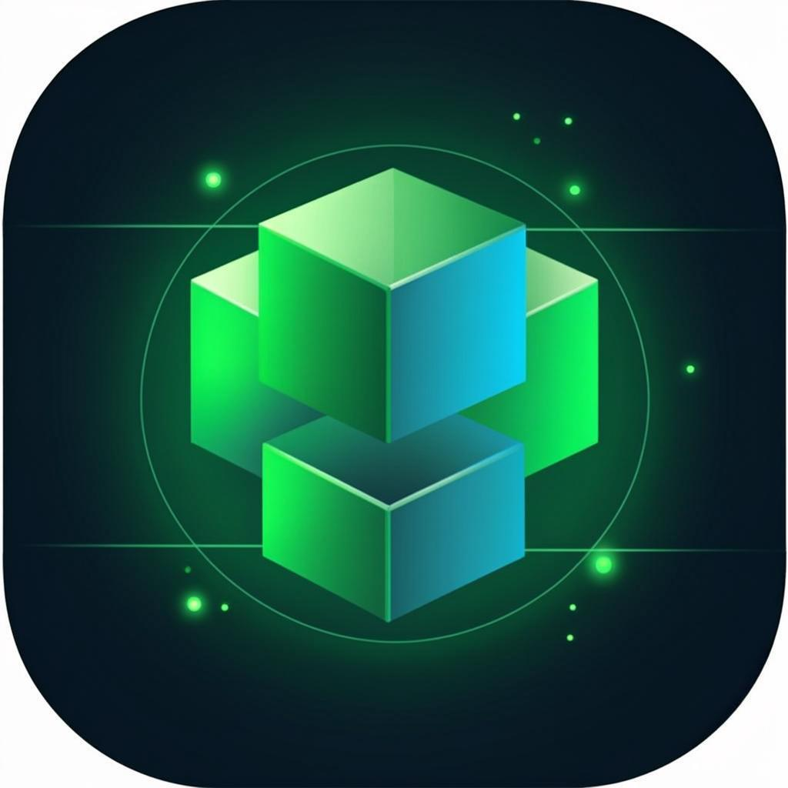
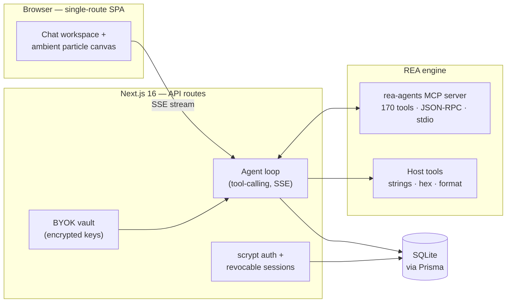

<div align="center">



# REA — Reverse Engineer Anything

**A browser-native, AI-powered reverse-engineering platform.**

Chat in plain language. A real analysis engine runs **170 professional tools**
and answers with a graded evidence ledger — observations you can verify,
never guesses dressed as facts.

[](https://nextjs.org)
[](https://www.typescriptlang.org)
[](https://www.npmjs.com/package/rea-agents)
[](https://github.com/morluto/rea)
[](https://github.com/morluto/rea)

</div>

---

## ✨ What you get

| | |
|---|---|
| 🧠 **Real engine, real tools** | The `rea-agents` MCP engine runs as a real child process — artifact inspection, JavaScript application analysis, binary overview and 167 more tools, spoken to over strict JSON-RPC 2.0 on stdio. Nothing is simulated. |
| 💬 **Chat-first IDE shell** | Token-by-token SSE streaming, IDE-style code blocks, GFM tables, quote-reply, edit & resend, regenerate, and forking any message into a new branch of the conversation. |
| 🗂 **Targets & artifacts** | Upload a binary (≤ 50 MB, magic-byte validated) and every message, tool call and evidence row stays bound to that target. |
| 🔍 **Evidence-first ledger** | Every finding is graded **OBSERVED → DERIVED → INFERRED → UNKNOWN**. The UI deep-links straight to the raw evidence, so the line between measured and guessed is never blurred. |
| 🔑 **Zero-config chat, or BYOK** | Works out of the box on the platform's default GLM chat — with self-healing credentials (provider key rotations are detected and recovered automatically). Prefer your own? Drop OpenAI / Anthropic / Gemini / DeepSeek / Kimi / GLM keys into the encrypted vault. |
| 🧭 **Agent planning** | On multi-step work the agent emits a plan — a live checklist card tracks each step inside the transcript and survives reloads. |
| 🧮 **Honest accounting** | Per-message token counts, cost estimates, turn durations and live tool-run timers — sourced from actual provider payloads, not invented. |
| 🔊 **Read aloud** | Any assistant message can be spoken through TTS without leaving the page. |
| ⌨️ **Keyboard-first** | Command palette (`⌘K`), quick filters (`⌘F`), jump-to-message search with flash highlight, and a shortcuts cheat-sheet (`?`). |

## 🏗 Architecture



**One route, many rooms.** The whole product lives on `/` — home, chat,
inspector, targets, security and admin are client-side views. The server
exposes a small, honest REST surface (`/api/chat`, `/api/provider`,
`/api/capabilities`, `/api/security`, …) and speaks SSE for streaming turns.

## 🚀 Quickstart

**Prerequisites** — [Bun](https://bun.sh) (or Node 22+), and **Node ≥ 22.19** for the REA engine runtime.

```bash
git clone https://github.com/arpitnayan123-bot/reverse-engineering-agent.git
cd reverse-engineering-agent
bun install

# SQLite location (path is resolved relative to prisma/)
echo 'DATABASE_URL="file:../db/custom.db"' > .env

bun run db:push     # create the schema
bun run dev         # → http://localhost:3000
```

Open the app → **create your account** on the sign-in screen (or use the demo
button) → start chatting. Upload a binary from the composer and the whole
conversation binds to that target: evidence, tool traces and reports included.

> The engine **fails closed** by design: native providers (Ghidra / IDA /
> Hopper desktop apps) are bring-your-own and absent here — the agent reports
> that honestly instead of inventing results.

## 🔑 Model providers

| Mode | Behaviour |
|---|---|
| **Default — zero config** | Platform GLM chat. Credential rotations on the provider side are self-healed (auth-error detection drops the cached client and re-reads config). A dead session degrades to a clean re-login, never a stranded shell. |
| **BYOK vault** | Settings → Providers. Keys are encrypted at rest, never returned to the browser in plaintext, and validated with a live ping before you save. |

## 🛡 Security model

- **Auth** — scrypt password hashing, HMAC-signed HttpOnly cookies, **server-side revocable sessions** (sign out any device — or every other device — from the Security tab).
- **Uploads** — 50 MB cap, magic-byte validation, UUID storage names, one-file-at-a-time clarity.
- **Analysis** — engine and host tools run in child processes with timeouts, SIGKILL and output caps.
- **Isolation** — audit/threat views are scoped to the requesting user; heavy endpoints are rate-limited; an append-only audit log records security events.
- **Secrets** — never hardcoded: environment → persisted secret file (0600) → generated at first boot. User databases and uploads are runtime data and are **never** part of the repository history.

## ⌨️ Keyboard

`⌘K` command palette · `⌘F` quick filter · `⌘I` inspector / export · `?` full cheat-sheet — the in-app sheet is generated from the real bindings.

## 📁 Repository layout

```
src/app/                 Next.js App Router — single-route UI + /api/* handlers
src/components/rea/      Chat workspace, home, inspector, security, admin
src/lib/                 Engine bridge (MCP stdio), agent loop, auth, vault, tools
prisma/schema.prisma     SQLite schema — users, sessions, chats, evidence, audit
public/                  Static assets
scripts/                 Maintenance (seed, verify engine bridge, wipe chats)
skills/, examples/       Bundled tooling & reference examples
```

## 🙏 Credits & lineage

Built on the open-source **REA** project —
[morluto/rea](https://github.com/morluto/rea) (published as
[`rea-agents`](https://www.npmjs.com/package/rea-agents), MIT-licensed).
The engine, its 170-tool MCP server and the evidence-first philosophy belong
to that project; this repository wraps it in a production-grade browser
platform.

---

<div align="center">
<sub>Reverse Engineer Anything — ask questions, get evidence.</sub>
</div>
