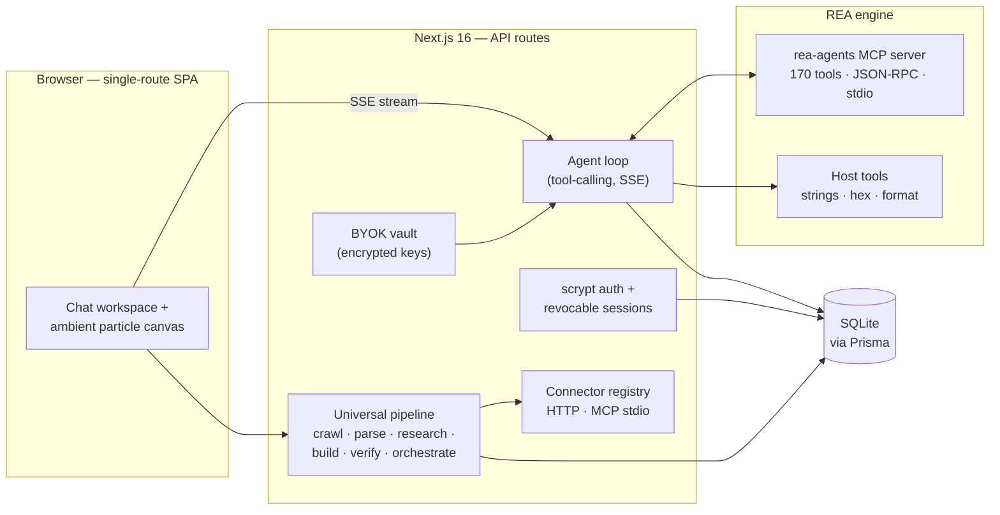

<div align="center">


# REA — Reverse Engineer Anything

**A browser-native AI platform for software intelligence & reconstruction.**

Chat in plain language. A real analysis engine runs **170 professional tools**,
a universal pipeline crawls sites, parses repositories, maps architecture,
researches ecosystems, scaffolds code and verifies results — and every claim
lands in a graded evidence ledger: observations you can verify, never guesses
dressed as facts.

[](https://nextjs.org)
[](https://www.typescriptlang.org)
[](https://www.npmjs.com/package/rea-agents)
[](https://github.com/morluto/rea)
[](https://github.com/morluto/rea)

</div>

---

## ✨ What you get

| | |
|---|---|
| 🧠 **Real engine, real tools** | The `rea-agents` MCP engine runs as a real child process — artifact inspection, JavaScript application analysis, binary overview and 167 more tools, spoken to over strict JSON-RPC 2.0 on stdio. Nothing is simulated. |
| 💬 **Chat-first IDE shell** | Token-by-token SSE streaming, IDE-style code blocks, GFM tables, quote-reply, edit & resend, regenerate, and forking any message into a new branch of the conversation. |
| 🗂 **Targets & artifacts** | Upload a binary (≤ 50 MB, magic-byte validated) and every message, tool call and evidence row stays bound to that target. |
| 🔍 **Evidence-first ledger** | Every finding is graded **OBSERVED → DERIVED → INFERRED → UNKNOWN**. The UI deep-links straight to the raw evidence, so the line between measured and guessed is never blurred. |
| 🔑 **Zero-config chat, or BYOK** | Works out of the box on the platform's default GLM chat — with self-healing credentials (provider key rotations are detected and recovered automatically). Prefer your own? Drop OpenAI / Anthropic / Gemini / DeepSeek / Kimi / GLM keys into the encrypted vault. |
| 🔎 **Universal pipeline (PLATFORM mode)** | One goal in — `DISCOVER → COLLECT → UNDERSTAND → MAP → RESEARCH → PLAN → BUILD → TEST → VERIFY` out. Websites are crawled politely (robots.txt, SSRF-guarded, technology fingerprinting, optional headless-Chromium render), GitHub repos are materialized and parsed with tree-sitter (22+ languages, AST-level symbols/imports/routes), research reports carry citations, and PLAN/BUILD pause for **human approval** before a single file is written. |
| 🧩 **Eight integrated capabilities** | Explorer (crawl + render + DOM extract) · Reverse Engineer (AST recon + endpoint/secret heuristics) · Research Agent (cited web/GitHub/docs/YouTube) · Builder (isolated workspace, guarded file ops, allowlisted no-shell terminal) · Verification (functional checks, reference diff, regression scoring) · Universal Connectors (HTTP + MCP-stdio, sealed headers) · Knowledge Graph (SQLite entities/relations with provenance) · Orchestration (persisted DAG, retries, checkpoints, cancel, approvals). |
| 🧭 **Agent planning** | On multi-step work the agent emits a plan — a live checklist card tracks each step inside the transcript and survives reloads. |
| 🧮 **Honest accounting** | Per-message token counts, cost estimates, turn durations and live tool-run timers — sourced from actual provider payloads, not invented. |
| 🔊 **Read aloud** | Any assistant message can be spoken through TTS without leaving the page. |
| ⌨️ **Keyboard-first** | Command palette (`⌘K`), quick filters (`⌘F`), jump-to-message search with flash highlight, and a shortcuts cheat-sheet (`?`). |

## 🏗 Architecture



**One route, many rooms.** The whole product lives on `/` — home, chat,
inspector, targets, security, the universal platform workspace and admin are
client-side views. The server exposes a small, honest REST surface
(`/api/chat`, `/api/projects/*`, `/api/connectors`, `/api/capabilities`,
`/api/security`, …) and speaks SSE for streaming turns.

## 🚀 Quickstart

**Prerequisites** — [Bun](https://bun.sh) (or Node 22+), and **Node ≥ 22.19** for the REA engine runtime.

```bash
git clone https://github.com/arpitnayan123-bot/reverse-engineering-agent.git
cd reverse-engineering-agent
bun install

# SQLite location (path is resolved relative to prisma/)
echo 'DATABASE_URL="file:../db/custom.db"' > .env

bun run db:push     # create the schema
bun run dev         # → http://localhost:3000
```

Open the app → **create your account** on the sign-in screen (or use the demo
button) → start chatting. Upload a binary from the composer and the whole
conversation binds to that target: evidence, tool traces and reports included.

> The engine **fails closed** by design: native providers (Ghidra / IDA /
> Hopper desktop apps) are bring-your-own and absent here — the agent reports
> that honestly instead of inventing results. The same doctrine governs the
> universal pipeline: a rate-limited GitHub API, a missing Chromium runtime or
> an unreachable site is reported as exactly that — never simulated.

## 🌐 The universal pipeline (PLATFORM mode)

Toggle **CHAT / PLATFORM** in the top bar. Create a project from a website URL,
an `owner/repo` pair, or an uploaded target, then:

1. **Run the pipeline** with a goal — steps execute as a persisted DAG with
   retries, timeouts, checkpoints and cancellation; independent steps run in
   parallel.
2. **Approve at the gates** — the PLAN and BUILD stages park the pipeline and
   wait for a human decision. Rejecting a gate stops the run honestly.
3. **Inspect the outputs** — crawled pages with tech fingerprints, a knowledge
   graph (pages, symbols, endpoints, dependencies — each node tagged
   OBSERVED / DERIVED / INFERRED / UNKNOWN), cited research reports, a workspace
   file editor + terminal, and verification runs scored 0–100 with regression
   detection.

Optional capabilities are detected, never faked: install a Chromium runtime
(`bunx playwright-core install chromium`) to enable rendered screenshots and
browser-backed verification checks; set `GITHUB_TOKEN` to lift GitHub API rate
limits (or register an `api.github.com` HTTP connector — **GitHub research
automatically uses its sealed auth headers**, no restart needed); register HTTP
or MCP connectors (auth headers are sealed with the same AES-256-GCM vault as
provider keys) under **Connectors**.

Third-party licensing is documented in [`THIRD_PARTY_NOTICES.md`](THIRD_PARTY_NOTICES.md);
the ecosystem audit lives at [`docs/ecosystem-audit.md`](docs/ecosystem-audit.md).

## 🔌 MCP server — drive REA from any coding agent

REA ships an MCP (Model Context Protocol) stdio server that exposes the whole
platform — projects, pipeline, explorer, recon, research, knowledge graph,
builder workspace, verifier and connector registry — to external coding agents
(Claude Code, Cursor, Codex, or any MCP client):

```bash
bun run mcp:token -- --demo          # mint a session token (or --email/--password)
REA_MCP_TOKEN=<token> bun run mcp:server
```

- **20 tools** — `rea_health`, `rea_list_projects`, `rea_create_project`,
  `rea_crawl`, `rea_recon`, `rea_research`, `rea_graph`, `rea_verify`,
  `rea_probe_url` (single-page Explorer probe — SSRF-guarded, no project
  needed), `rea_crawl_url` (bounded same-domain deep crawl — depth/page
  caps, visited set, structured results), `rea_workspace_op`,
  `rea_orchestrate` (start / approve / cancel gates),
  `rea_orchestration_status`, `rea_list_connectors`,
  `rea_connector_action` and friends — every one a 1:1 bridge onto the
  authenticated REST API.
- **One source of truth** — the server never touches the database or vault.
  Auth, ownership scoping, rate limits, sandboxing and auditing all stay in
  the platform; the token is held in memory only and renews itself when the
  API slides the session forward.
- **Honest results** — API errors surface as tool errors with the real HTTP
  status; nothing is faked to make an agent's life easier.

Point your MCP client at `bun scripts/mcp-server.ts` with
`REA_MCP_TOKEN` (and optionally `REA_MCP_URL`, default
`http://127.0.0.1:3000`) in its environment.

## 🔑 Model providers

| Mode | Behaviour |
|---|---|
| **Default — zero config** | Platform GLM chat. Credential rotations on the provider side are self-healed (auth-error detection drops the cached client and re-reads config). A dead session degrades to a clean re-login, never a stranded shell. |
| **BYOK vault** | Settings → Providers. Keys are encrypted at rest, never returned to the browser in plaintext, and validated with a live ping before you save. |

## 🛡 Security model

- **Auth** — scrypt password hashing, HMAC-signed HttpOnly cookies, **server-side revocable sessions** (sign out any device — or every other device — from the Security tab).
- **Uploads** — 50 MB cap, magic-byte validation, UUID storage names, one-file-at-a-time clarity.
- **Analysis** — engine and host tools run in child processes with timeouts, SIGKILL and output caps.
- **Isolation** — audit/threat views are scoped to the requesting user; heavy endpoints are rate-limited; an append-only audit log records security events.
- **Secrets** — never hardcoded: environment → persisted secret file (0600) → generated at first boot. User databases and uploads are runtime data and are **never** part of the repository history.

## ⌨️ Keyboard

`⌘K` command palette · `⌘F` quick filter · `⌘I` inspector / export · `?` full cheat-sheet — the in-app sheet is generated from the real bindings.

## 📁 Repository layout

```
src/app/                 Next.js App Router — single-route UI + /api/* handlers
src/components/rea/      Chat workspace, home, inspector, platform, security
src/server/agent/        Agent loop, providers, BYOK vault, prompts
src/server/platform/     Universal pipeline: explorer, recon, research,
                         builder, verifier, connectors, orchestrator, graph
src/server/engine/       REA MCP bridge (JSON-RPC over stdio)
prisma/schema.prisma     SQLite schema — users, chats, evidence, projects,
                         knowledge graph, orchestrations, connectors, audit
public/                  Static assets
scripts/                 Maintenance (seed, verify engine bridge, wipe chats)
docs/                    Ecosystem audit
skills/, examples/       Bundled tooling & reference examples
```

## 🙏 Credits & lineage

Built on the open-source **REA** project —
[morluto/rea](https://github.com/morluto/rea) (published as
[`rea-agents`](https://www.npmjs.com/package/rea-agents), MIT-licensed).
The engine, its 170-tool MCP server and the evidence-first philosophy belong
to that project; this repository wraps it in a production-grade browser
platform.

Integrated third-party packages: **cheerio** (MIT), **web-tree-sitter** (MIT),
**tree-sitter-wasms** (Unlicense), **diff** (BSD-3-Clause),
**playwright-core** (Apache-2.0, optional runtime), **@modelcontextprotocol/sdk**
(MIT) — full notices in [`THIRD_PARTY_NOTICES.md`](THIRD_PARTY_NOTICES.md).
Architecture was informed by (but does not redistribute code from)
OpenHands, browser-use, graphiti, langgraph, crawlee and firecrawl —
see the ecosystem audit for the license-driven decisions.

---

<div align="center">
<sub>Reverse Engineer Anything — ask questions, get evidence.</sub>
</div>
